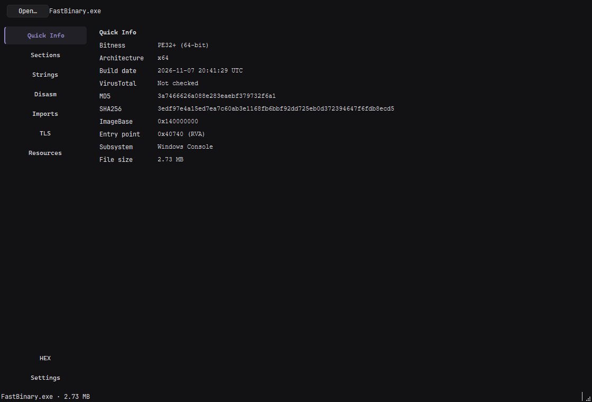
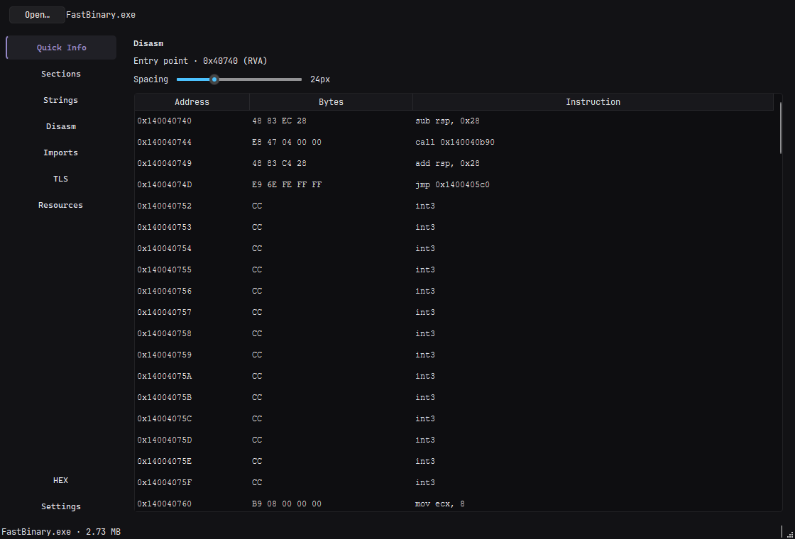
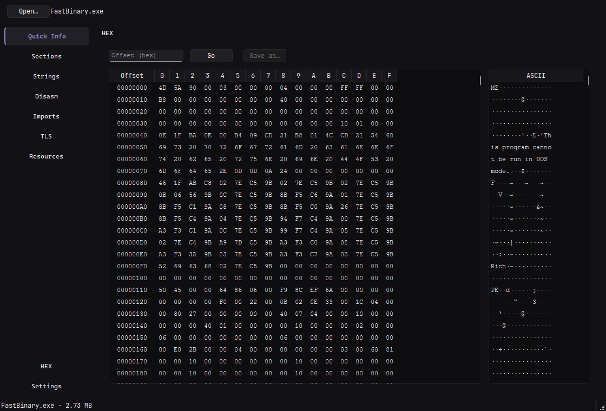

# FastBinary

[Русский](README.md)

Fast PE analyzer and HEX editor built with C++26, Qt 6 and Capstone.

## Features

- **Quick Info:** bitness, architecture, build date, MD5/SHA256, ImageBase, entry point and subsystem.
- **Sections:** addresses, sizes, characteristics and entropy for each section and the whole file.
- **Strings:** ASCII and UTF-16LE strings with offsets and filtering.
- **Disassembly:** x86/x64 via Capstone with adjustable column spacing.
- **Imports, TLS and resources:** libraries and functions, TLS fields and callbacks, resource types and sizes.
- **HEX:** synchronized byte and ASCII panes, editing, offset navigation and Save As.
- **Settings:** theme, UI language (EN/RU) and size units.







## Run

1. Download and extract an archive from [Releases](https://github.com/ZekiTRR/FastBinary/releases).
2. Run `FastBinary.exe`. No separate Qt installation is required.
3. Open a PE file with **Open…**, drag it onto the window or pass its path:

```powershell
FastBinary.exe path\to\file.exe
```

HEX changes are saved with **Save as…**; the original file is never overwritten.

## Build

Requirements: Windows, Visual Studio 2022+ with MSVC, CMake 3.20+, Ninja, Qt 6.12 (Widgets), Git.

Run these commands from **x64 Native Tools Command Prompt for VS**. Adjust `QT_ROOT` in `CMakeLists.txt` if Qt is installed elsewhere. Capstone and hash-library are fetched with CMake FetchContent.

```powershell
cmake --preset x64-release
cmake --build out/build/x64-release --parallel
```

The executable is written to `out/build/x64-release/FastBinary.exe`.

## Checks

The smoke test covers the PE parser, Capstone, tabs and HEX editing:

```powershell
ctest --test-dir out/build/x64-release -C Release --output-on-failure
```
