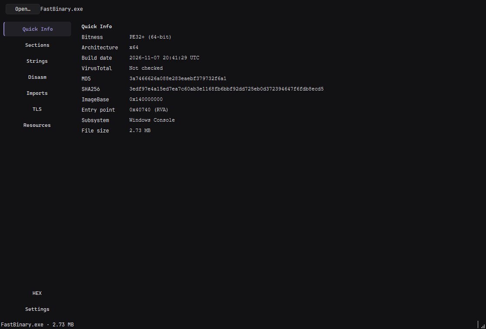
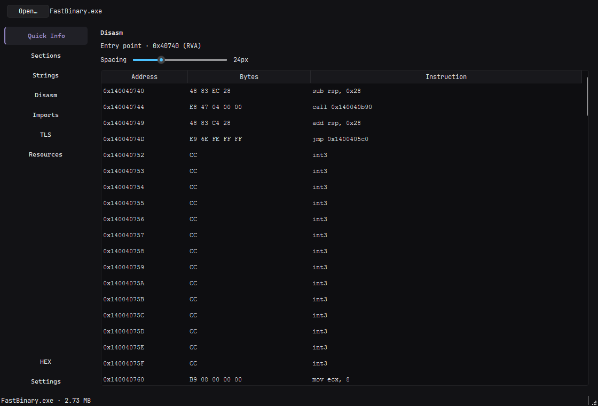
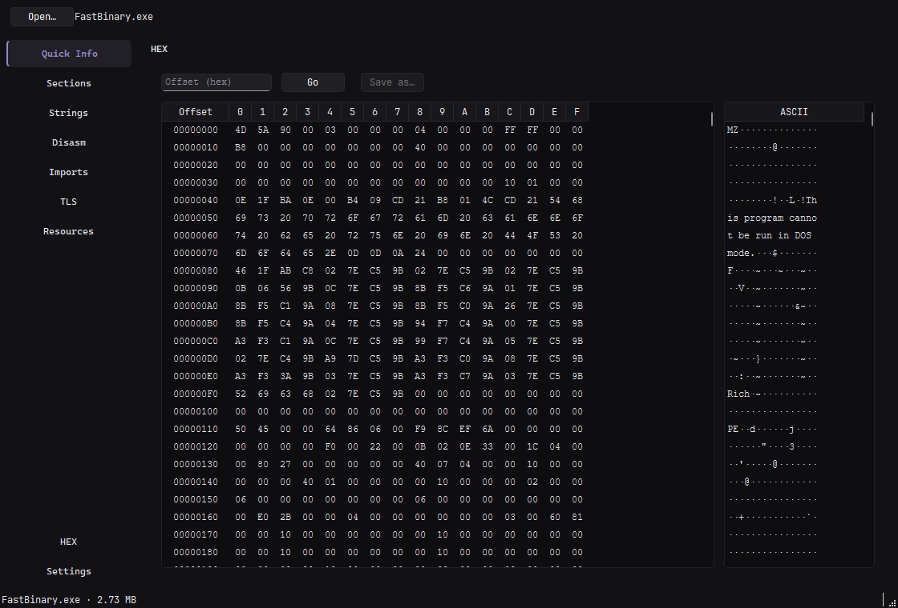

# FastBinary

[English](README.en.md)

Быстрый анализатор и HEX-редактор PE-файлов на C++26, Qt 6 и Capstone.

## Возможности

- **Сводка:** битность, архитектура, дата сборки, MD5/SHA256, ImageBase, точка входа, подсистема.
- **Секции:** адреса, размеры, характеристики и энтропия каждой секции и всего файла.
- **Строки:** ASCII и UTF-16LE с адресами и фильтром.
- **Дизассемблер:** x86/x64 через Capstone, регулируемый интервал между колонками.
- **Импорт, TLS и ресурсы:** библиотеки и функции, TLS-поля и callbacks, типы и размеры ресурсов.
- **HEX:** синхронные байтовая и ASCII-панели, редактирование, переход по смещению и сохранение копии.
- **Настройки:** тема, язык интерфейса (RU/EN), единицы размера.







## Запуск

1. Скачайте и распакуйте архив со страницы [Releases](https://github.com/ZekiTRR/FastBinary/releases).
2. Запустите `FastBinary.exe`. Дополнительная установка Qt не требуется.
3. Откройте PE-файл кнопкой **Open…**, перетащите его в окно или передайте путь аргументом:

```powershell
FastBinary.exe path\to\file.exe
```

Изменения в HEX сохраняются через **Save as…** — исходный файл не перезаписывается.

## Сборка

Требования: Windows, Visual Studio 2022+ с MSVC, CMake 3.20+, Ninja, Qt 6.12 (Widgets), Git.

Выполняйте команды из **x64 Native Tools Command Prompt for VS**. При необходимости измените `QT_ROOT` в `CMakeLists.txt`. Capstone и hash-library загружаются через CMake FetchContent.

```powershell
cmake --preset x64-release
cmake --build out/build/x64-release --parallel
```

Готовый файл: `out/build/x64-release/FastBinary.exe`.

## Проверки

Smoke-тест проверяет PE-парсер, Capstone, вкладки и редактирование HEX:

```powershell
ctest --test-dir out/build/x64-release -C Release --output-on-failure
```
